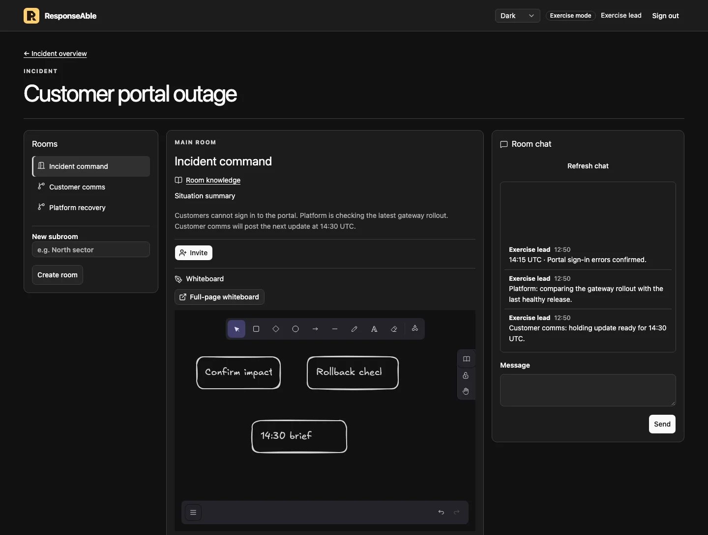
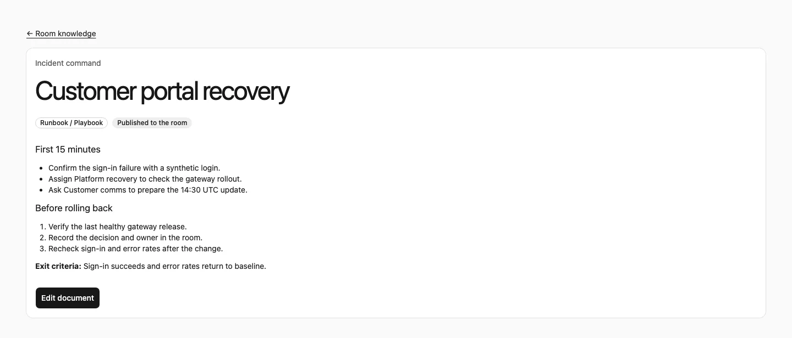
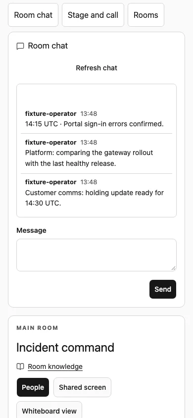

ResponseAble is a self-hosted incident war room for coordinating responders across rooms, chat, whiteboards and meetings.



## Try it on Kubernetes

Use Git, a POSIX shell, OpenSSL, curl and an authenticated `kubectl` context. The cluster needs a default StorageClass for two 1 GiB claims, permission to create a dedicated test namespace, and access to the public image registries, GitHub releases and npm. The PostgreSQL pilot uses an unconfined AppArmor profile on K3s; use a test cluster that permits it.

```sh
git clone https://tea.karlcom.de/karl/responseable.git
cd responseable && ./scripts/kubernetes-mvp.sh
```

Keep the launcher running and open **http://127.0.0.1:3190**. Choose **Run the exercise**, open a meeting, and redeem an invite in a separate browser profile on the same workstation. Leave local TCP ports **3190, 7880, 7881 and 7883** free. The test bundles LiveKit, Converse, ejabberd with a PostgreSQL archive, and seeded rooms with chat, whiteboard and room knowledge. The launcher generates test secrets. Local Docker, npm and provider credentials are unnecessary.

This is a disposable single-replica environment. ejabberd state and its archive use persistent volumes. The exercise app database survives container restarts within its pod and resets on pod replacement. For a fresh reinstall or cleanup, stop the launcher and use `kubectl delete namespace responseable-mvp`. Set `RESPONSEABLE_EXERCISE_NAMESPACE` to choose a different fresh namespace. Check `curl -fsS http://127.0.0.1:3190/health/ready` once all forwards are ready. If the launcher reports a forward failure, check the named port and use a fresh namespace for a new exercise.

The [GitHub mirror](https://github.com/Karlcom-de/responseable) can replace the Gitea clone URL. For browsers on other machines use a private HTTPS/WSS origin, a stable passkey RP ID and an independently reachable ICE or TURN path. See [Kubernetes deployment](docs/kubernetes.md) and [XMPP configuration](deploy/xmpp/README.md). Telephony and AI remain opt-in. The smaller launcher `./scripts/kubernetes-exercise.sh` provides the app-only exercise with local chat.

## What you can do

- Open an incident with a command room and add workstream rooms as the response evolves.
- Share an expiring, room-specific invitation with a guest.
- Keep chat and the incident whiteboard available across reloads and application restarts.
- Use LiveKit for video, audio and screen sharing. Invite an individual by SMS, place a mobile call through a compatible gateway, or dial a phone participant into a meeting with LiveKit SIP.

## Screenshots





## Quick start

Install Node.js 24 LTS, npm and PostgreSQL, or use Docker Compose for the local database. Run from the repository root.

```sh
docker compose up -d --wait
npm ci
cp .env.example .env.local
npm run migrate
npm run dev -- --hostname 127.0.0.1
```

Open `http://localhost:3000` and select **Run the exercise** on the welcome page. The example uses a dedicated local database and simulated incident data. Demo mode disables external media and phone operations. If you already have PostgreSQL, skip Compose and put your empty database's connection string in `DATABASE_URL`.

For a real instance, use a separate PostgreSQL database, set `RESPONSEABLE_MODE=real`, configure `RESPONSEABLE_OPERATOR`, and set `RESPONSEABLE_PASSWORD_HASH` to the output of `node scripts/password.mjs`. The script reads the password from standard input. Protect the configured origin with HTTPS and set `RESPONSEABLE_SECURE_COOKIE=true`. The origin must match the exact address users open, including the port if present.

## Integrations

- **Meetings.** For a local real-mode test, run `livekit-server --dev` on the loopback interface. Set `LIVEKIT_URL=ws://127.0.0.1:7880`, `LIVEKIT_API_KEY=devkey` and `LIVEKIT_API_SECRET=secret`. Use your own keys, WSS and tested media/TURN routing in production. [LiveKit self-hosting](https://docs.livekit.io/transport/self-hosting/)
- **Whiteboard.** Excalidraw synchronizes shapes, text, arrows, lines, freehand strokes and frames. Each room supports up to 2,000 elements and 2 MB, including deletion markers.
- **Phone alerts.** Select SMS and outbound voice providers independently: Android, an authenticated HTTP webhook, or AWS End User Messaging. LiveKit SIP can dial a participant directly into a room. [Provider setup and webhook contract](docs/telephony.md)

## Deploy and verify

Use the [Kubernetes guide](docs/kubernetes.md) for Helm, PostgreSQL, LiveKit, backups and failover drills. The [staging guide](docs/staging.md) covers a one-replica development environment and the manual test. The [architecture notes](docs/architecture.md) describe the access model and outage boundaries.

```sh
npm run build
npm run typecheck
npx playwright install chromium
DATABASE_URL='postgresql://…/responseable_test' npm test
```

The acceptance test starts two app processes on ports 3130 and 3131 and exercises shared state, guest permissions and a mock phone gateway. Pass the local LiveKit variables above to test a real WebRTC connection with synthetic camera input. Use a separate test database.

## Contribute

See the [brand assets](docs/brand.md) and [product brief](docs/marketing.md) for project communications. See [CONTRIBUTING.md](CONTRIBUTING.md) for reporting issues and running the checks. ResponseAble is distributed under the [MIT License](LICENSE).
