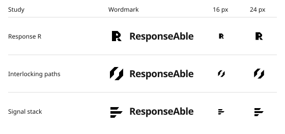

# ResponseAble · Marke und Oberfläche

Die Kopfzeile verbindet das Response-R mit dem Schriftzug **ResponseAble**. Das [App-Icon](../app/icon.svg) und die [Wort-Bild-Marke](responseable-lockup.svg) sind editierbare SVGs. Das Icon verwendet eine feste Amber-Fläche (#FFCF70), damit es auf hellem und dunklem Grund lesbar bleibt. Die Wortmarke passt ihre Textfarbe an das Farbschema an. Die Oberfläche nutzt Nachtblau, Schiefer und Amber als einzigen Akzent.

## Visuelle Referenzen

- Das Brand Center von incident.io dokumentiert Zeichen, Farbe und Typografie als zusammengehöriges System. ResponseAble verwendet eine eigene, eckige Raumgeometrie. [incident.io Brand Center](https://incident.io/brand)
- Linear dokumentiert Wortmarke und Symbol getrennt, mit Regeln für einfarbigen Einsatz und Freiraum. ResponseAble verwendet die frei stehende Silhouette im Browser und den ausgeschriebenen Namen im Produkt. [Linear Brand Guidelines](https://linear.app/brand)
- GOV.UK bietet eine unabhängige Referenz für klare Beschriftungen, konsistente Bedienelemente und sichtbaren Fokus. In ResponseAble bleiben Raum, Lagebild und Chat ausgeschrieben. [GOV.UK Design System](https://design-system.service.gov.uk/)

## Drei Entwürfe

| Entwurf | Form | Entscheidung |
| --- | --- | --- |
| Response R | Winkeliger Buchstabe mit versetztem Fuß | Gewählt. Der kräftige Stamm und der getrennte Fuß ergeben eine erkennbare Silhouette. |
| Interlocking paths | Zwei gegenläufige Formen greifen ineinander | Vermittelt Zusammenarbeit, wirkt in kleiner Darstellung stärker wie ein Richtungssymbol. |
| Signal stack | Drei gestaffelte Balken | Gut skalierbar, wirkt eher wie ein Status- oder Menüsymbol. |

Lucide-Symbole stützen die beschrifteten Bereiche und Aktionen. Die Raumliste zeigt Haupt- und Unterräume mit Tür- und Verzweigungssymbol. Die aktive Zeile erhält zusätzlich eine sichtbare Kante.

## Produktaufnahmen

Englische Oberfläche aus einer synthetischen Übung, aufgenommen direkt im Browser. [Einsatzraum am Desktop](incident-room-desktop.webp), [Runbook](runbook-desktop.webp) und [Gastansicht am Smartphone](incident-room-mobile.webp).

## UX-Pfade

- Leitung → Übung starten oder anmelden → Einsatzraum öffnen → Unterraum für einen Arbeitsstrang wählen → Entscheidung am Lagebild festhalten.
- Gast → Einladung öffnen → zugeordneten Raum betreten.
- Mobil → über Sprunglinks zwischen Räumen, Lage und Chat wechseln.
